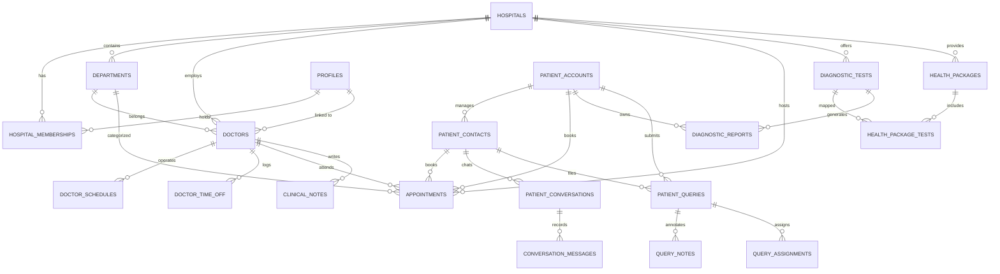

# Database Plan & Data Model Specification
## Authoritative PostgreSQL Schema on Supabase

---

### 1. Database Selection & Architecture Justification

**Selected Database**: **PostgreSQL (Managed via Supabase)**.

#### Architectural Rationale:
1. **Compatibility with Existing Assets**: `HIRAMANI-MEDICONNECT` already possesses a mature, tested PostgreSQL schema in `supabase/migrations/` with relational foreign keys and RLS policies. Adopting Supabase PostgreSQL builds directly upon this foundation.
2. **ACID Transactions & Double-Booking Elimination**: Medical appointment scheduling requires strict transactional consistency. PostgreSQL partial unique indexes (`idx_appointments_no_double_booking`) guarantee that conflicting reservations fail atomically at the database engine level.
3. **Row Level Security (RLS)**: Enforces access boundaries directly within the database. Even if an API handler has a bug, a patient can only query their own medical records, and doctors can only view appointments assigned to their department/roster.
4. **Private Storage Integration**: Supabase Storage provides private S3-compatible buckets with granular RLS policies and time-limited cryptographically signed URLs for patient diagnostic PDF reports.
5. **Single Source of Truth**: Completely avoids dual databases. The public website, patient portal, staff dashboard, and WhatsApp bot all communicate with this single PostgreSQL instance.

---

### 2. Comprehensive Entity Relationship Diagram (ERD)



---

### 3. Detailed Table Specifications

#### A. Core Identity, Tenancy & Roles
1. **`public.hospitals`**: Tenant profile (Hiramani Memorial Hospital, registration number, address, contact numbers, GPS URL, timezone).
2. **`public.profiles`**: Staff and administrative user profiles linked to Supabase `auth.users(id)`.
3. **`public.hospital_memberships`**: RBAC permissions mapping users to roles:
   * `super_admin`: Full hospital ERP access.
   * `hospital_admin`: Operational management (doctors, departments, CMS).
   * `doctor`: Clinical portal access (OPD schedule, queue, clinical notes).
   * `receptionist`: Walk-in bookings, appointment status, inquiry ticketing.
   * `lab_technician`: Diagnostic report uploads, lab test catalog management.
4. **`public.hospital_settings`**: Operational rules (OPD clinic timings, visiting hours, cancellation cutoff hours, advance booking limit, WhatsApp credentials).

#### B. Patient Records & Self-Service Portal
5. **`public.patient_accounts`**: Registered patient portal users linked to `auth.users(id)`:
   * `id` UUID PRIMARY KEY REFERENCES auth.users(id)
   * `full_name` TEXT NOT NULL
   * `phone_number` TEXT NOT NULL UNIQUE (E.164 format)
   * `email` TEXT UNIQUE
   * `date_of_birth` DATE
   * `gender` TEXT CHECK (gender IN ('male', 'female', 'other'))
   * `blood_group` TEXT CHECK (blood_group IN ('A+', 'A-', 'B+', 'B-', 'AB+', 'AB-', 'O+', 'O-'))
   * `emergency_contact_name` TEXT
   * `emergency_contact_phone` TEXT
   * `preferred_language` TEXT DEFAULT 'en' CHECK (preferred_language IN ('en', 'bn', 'hi'))
6. **`public.patient_contacts`**: Unregistered and WhatsApp patient directory (records phone, consent, and language preference). Links to `patient_accounts` when a patient registers.

#### C. Clinical Roster & Doctor Management
7. **`public.departments`**: Medical specialties (e.g., General Medicine, Cardiology, Orthopaedics, Gynaecology, Paediatrics, ENT, Dermatology) with codes, descriptions, and icon names.
8. **`public.doctors`**: Doctor directory:
   * `full_name`, `qualification` (e.g., MBBS, MD, DM), `speciality`, `experience_years`, `bio`, `consultation_fee`, `follow_up_fee`, `room_number`, `profile_image_url`, `is_active`, `display_order`.
9. **`public.doctor_schedules`**: Weekly recurring OPD slots:
   * `day_of_week` (0 = Sunday to 6 = Saturday), `start_time`, `end_time`, `slot_duration_minutes` (e.g., 15 or 20 mins), `max_patients_per_slot`.
10. **`public.doctor_time_off`**: Leave and unavailable dates (`start_date`, `end_date`, `reason`).

#### D. Appointments & Scheduling Engine
11. **`public.appointments`**:
   * `booking_reference` TEXT NOT NULL UNIQUE (e.g., `HMH-202611-8942`)
   * `doctor_id` UUID NOT NULL REFERENCES public.doctors(id)
   * `department_id` UUID NOT NULL REFERENCES public.departments(id)
   * `patient_account_id` UUID REFERENCES public.patient_accounts(id)
   * `patient_name` TEXT NOT NULL
   * `patient_phone` TEXT NOT NULL
   * `appointment_date` DATE NOT NULL
   * `start_time` TIME NOT NULL
   * `end_time` TIME NOT NULL
   * `status` TEXT NOT NULL DEFAULT 'confirmed' CHECK (status IN ('requested', 'confirmed', 'reschedule_requested', 'cancelled', 'completed', 'no_show'))
   * `booking_channel` TEXT NOT NULL CHECK (booking_channel IN ('whatsapp', 'web_portal', 'phone', 'walk_in'))
   * `consultation_fee` NUMERIC(10, 2) NOT NULL
   * `payment_status` TEXT NOT NULL DEFAULT 'pay_at_hospital' CHECK (payment_status IN ('pay_at_hospital', 'online_paid', 'exempted'))
   * `cancellation_reason` TEXT

**Concurrency Constraint**:
```sql
CREATE UNIQUE INDEX idx_appointments_no_double_booking 
ON public.appointments(doctor_id, appointment_date, start_time) 
WHERE status NOT IN ('cancelled');
```

12. **`public.clinical_notes`**: Doctor consultation notes recorded during patient visits:
   * `appointment_id` UUID REFERENCES public.appointments(id)
   * `doctor_id` UUID REFERENCES public.doctors(id)
   * `diagnosis_summary` TEXT
   * `prescription_notes` TEXT
   * `follow_up_date` DATE
   * `created_at` TIMESTAMPTZ DEFAULT NOW()

#### E. Diagnostics, Health Packages & Medical Reports
13. **`public.diagnostic_categories`**: Test groups (`Pathology / Biochemistry`, `Radiology & Imaging`, `Cardiology Non-Invasive`, `Health Checkups`).
14. **`public.diagnostic_tests`**:
   * `name` TEXT NOT NULL (e.g., "Complete Blood Count", "HbA1c Glycated Hemoglobin", "Lipid Profile", "Digital Chest X-Ray", "USG Whole Abdomen", "12-Lead ECG", "2D Echocardiogram with Doppler")
   * `category_id` UUID REFERENCES public.diagnostic_categories(id)
   * `code` TEXT NOT NULL UNIQUE (e.g., `TEST-CBC`, `TEST-LIPID`)
   * `price` NUMERIC(10, 2) NOT NULL
   * `fasting_required` BOOLEAN DEFAULT FALSE NOT NULL
   * `preparation_instructions` TEXT (e.g., "10-12 hours overnight fasting required")
   * `sample_type` TEXT (e.g., "Blood (EDTA)", "Urine", "N/A - Imaging")
   * `turnaround_hours` INT DEFAULT 24 NOT NULL
   * `is_active` BOOLEAN DEFAULT TRUE NOT NULL
15. **`public.health_packages`**:
   * `name` TEXT NOT NULL (e.g., "Executive Health Checkup", "Comprehensive Cardiac Wellness", "Senior Citizen Health Package", "Women's Wellness Plan")
   * `slug` TEXT NOT NULL UNIQUE
   * `description` TEXT
   * `price` NUMERIC(10, 2) NOT NULL
   * `discounted_price` NUMERIC(10, 2) NOT NULL
   * `recommended_for` TEXT
   * `is_active` BOOLEAN DEFAULT TRUE NOT NULL
16. **`public.health_package_tests`**: Junction table mapping tests included in each package.
17. **`public.diagnostic_reports`**:
   * `id` UUID PRIMARY KEY DEFAULT uuid_generate_v4()
   * `patient_account_id` UUID REFERENCES public.patient_accounts(id)
   * `patient_phone` TEXT NOT NULL
   * `patient_name` TEXT NOT NULL
   * `test_id` UUID REFERENCES public.diagnostic_tests(id)
   * `test_name` TEXT NOT NULL
   * `report_date` DATE NOT NULL
   * `storage_path` TEXT NOT NULL (Path in private Supabase Storage bucket)
   * `file_name` TEXT NOT NULL
   * `mime_type` TEXT DEFAULT 'application/pdf' NOT NULL
   * `file_size_bytes` BIGINT NOT NULL
   * `technician_id` UUID REFERENCES public.profiles(id)
   * `status` TEXT DEFAULT 'ready' CHECK (status IN ('processing', 'ready', 'delivered'))
   * `notification_sent` BOOLEAN DEFAULT FALSE NOT NULL
   * `download_count` INT DEFAULT 0 NOT NULL
   * `created_at` TIMESTAMPTZ DEFAULT NOW() NOT NULL

#### F. WhatsApp Messaging & Support CRM
18. **`public.patient_conversations`**: WhatsApp session states (`phone`, `current_state`, `state_payload`, `is_human_handover`, `last_interaction_at`).
19. **`public.conversation_messages`**: Chat audit trail (`direction`, `message_type`, `body`, `whatsapp_message_id`, `delivery_status`).
20. **`public.patient_queries`**: Support ticketing system (`ticket_number`, `category`, `subject`, `description`, `status`, `priority`, `assigned_to`).
21. **`public.query_notes`**: Internal staff comments on tickets.
22. **`public.faqs`**: Knowledge base entries for trilingual bot and AI assistant.

#### G. Content Management System (CMS) & Governance
23. **`public.cms_announcements`**: Hospital news, Dengue advisories, health camp schedules, emergency alerts.
24. **`public.cms_careers`**: Job openings, job descriptions, qualifications.
25. **`public.audit_logs`**: Tamper-evident logging of administrative actions, report downloads, and appointment modifications.

---

### 4. Row Level Security (RLS) Strategy

```sql
-- Enable RLS on all sensitive tables
ALTER TABLE public.patient_accounts ENABLE ROW LEVEL SECURITY;
ALTER TABLE public.appointments ENABLE ROW LEVEL SECURITY;
ALTER TABLE public.diagnostic_reports ENABLE ROW LEVEL SECURITY;
ALTER TABLE public.patient_queries ENABLE ROW LEVEL SECURITY;

-- 1. Patient Accounts: Patients can only read & update their own profile
CREATE POLICY "Patients view own profile" 
ON public.patient_accounts 
FOR SELECT 
USING (auth.uid() = id);

CREATE POLICY "Patients update own profile" 
ON public.patient_accounts 
FOR UPDATE 
USING (auth.uid() = id);

-- 2. Diagnostic Reports: Patients can only view reports belonging to their account
CREATE POLICY "Patients view own diagnostic reports" 
ON public.diagnostic_reports 
FOR SELECT 
USING (
  auth.uid() = patient_account_id 
  OR EXISTS (
    SELECT 1 FROM public.hospital_memberships m 
    WHERE m.user_id = auth.uid() 
    AND m.role IN ('super_admin', 'hospital_admin', 'lab_technician', 'doctor')
  )
);

-- 3. Appointments: Patients can view their own; Staff can view hospital appointments
CREATE POLICY "Patients view own appointments" 
ON public.appointments 
FOR SELECT 
USING (
  auth.uid() = patient_account_id 
  OR EXISTS (
    SELECT 1 FROM public.hospital_memberships m 
    WHERE m.user_id = auth.uid() 
    AND m.is_active = TRUE
  )
);
```

---

### 5. Migration Execution Strategy

To preserve existing data while upgrading to the complete schema:
* **Migration 1 (`20261025000000_init_schema.sql`)**: Base schema from MediConnect (Hospitals, Profiles, Doctors, Schedules, Appointments, Conversations, Queries, FAQs).
* **Migration 2 (`20261025000001_hiramani_memorial_update.sql`)**: Hiramani Memorial hospital record update and 7-category constraint.
* **Migration 3 (`20261107000000_healthcare_platform_expansion.sql`)**: Add `patient_accounts`, `diagnostic_categories`, `diagnostic_tests`, `health_packages`, `health_package_tests`, `diagnostic_reports`, `clinical_notes`, and `cms_announcements` with comprehensive RLS and storage buckets.

